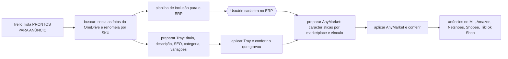
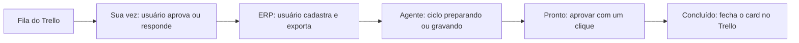

# Cadastro de produtos com agentes de IA

Pipeline que cadastra produtos de uma loja de artigos esportivos em marketplaces (Tray e AnyMarket, de onde
saem Mercado Livre, Amazon, Netshoes, Shopee e TikTok Shop), do card no Trello até o anúncio conferido.
Construído em Python com **Claude Code**, **Codex (GPT)** e **Gemini** entre setembro e novembro de 2026,
para o meu próprio trabalho como analista de e-commerce.

> **Sobre este repositório.** É uma vitrine. O pipeline completo é da empresa e fica privado: ele contém
> credenciais, SKUs, preços e perfis de navegador logados. Aqui estão a arquitetura, os números medidos e
> os módulos genéricos que não dependem de nada da empresa, com os testes que rodam sozinhos.

## O problema

Cadastrar um produto com variações (cores e tamanhos) levava mais de uma hora: achar as fotos no OneDrive,
preencher a planilha do ERP, escrever título, descrição e SEO, criar o produto na Tray, esperar ele aparecer
no AnyMarket, preencher as características obrigatórias de cada marketplace e vincular tudo. Cada etapa tinha
regra própria, e um erro em qualquer uma derrubava o anúncio depois.

## O que o pipeline faz



- **Um ciclo agendado** roda a cada 30 minutos (Agendador do Windows): lê o Trello, monta os lotes, prepara
  tudo o que dá e deixa pronto para aprovação. O agente escreve os textos de SEO que faltam e confere título
  duplicado, kit no título e meta sem diferencial antes de mostrar.
- **O agente nunca grava sem a frase do usuário.** Toda gravação exige `--user-quote` com a frase exata que
  a pessoa escreveu depois de ver a tabela. Frase inventada, reaproveitada de outra conversa ou de uma
  tentativa que falhou é recusada.
- **Confere o que gravou.** Depois de aplicar, o pipeline relê a Tray e o AnyMarket e compara com o plano.
  Só então marca `gravado_verificado`.
- **Erro conhecido ele corrige; erro novo, ele para e pergunta.** As respostas do usuário viram regra
  no `AGENTS.md` do projeto, e a mesma pergunta não volta.

## Números medidos (07/10 a 06/11/2026)

| Métrica | Valor |
|---|---|
| Gravações na Tray e no AnyMarket | 221 |
| SKUs distintos cadastrados | 100 |
| Gravações verificadas sem erro | 192 (87%) |
| Aprovadas de primeira, sem correção do usuário | 199 (90%) |
| Lotes processados pelo ciclo desde 29/09 | 63 |
| Tempo de um cadastro com variações | de mais de 1 h para cerca de 10 min |
| Testes automatizados nos 3 projetos | 2.159 (480 + 685 + 994) |

Os números vêm do log do modo sombra (abaixo), não de estimativa.

## Painel: a ferramenta interna

Aplicação web local em Python (só biblioteca padrão) e um HTML sem framework. Cada produto vira um card
e a coluna diz **de quem é a vez**:



- Aprovar com um clique chama o próprio `lote.py`, então todas as travas continuam valendo.
- Conversa com o agente (Claude ou ChatGPT) na própria tela, por produto.
- Arrastar um card muda a prioridade, e o ciclo passa a atender nessa ordem.
- Feito em um dia (05/11/2026), com 64 testes Python e 9 testes da interface.

A tela não está aqui porque mostra produtos, SKUs e nomes de pessoas da equipe.

## Autonomia por dado, não por palpite

Os módulos em [`modulos/`](modulos/) são a parte do pipeline que decide **quando o agente pode agir
sozinho** e **como ele conversa com o usuário e com o outro agente**. Nenhum deles depende da empresa.

| Módulo | O que faz | Testes |
|---|---|---|
| [`sombra.py`](modulos/sombra.py) | **Modo sombra.** A cada tabela mostrada, guarda a impressão (hash) do que o usuário viu. No aplicar, registra se ele aprovou de primeira ou pediu correção, por classe de operação (produto novo, cor nova, vínculo...). Só mede, nunca bloqueia. | [14](tests/test_sombra.py) |
| [`autonomia.py`](modulos/autonomia.py) | **Política de autonomia.** Nasce desligada. Uma classe só passa a ser aplicada sem perguntar quando o modo sombra mostra 10+ gravações, 95% aprovadas de primeira e zero falhas. Qualquer aviso (SEO, EAN gerado, categoria, tentativa que já falhou) devolve o lote ao usuário. Nunca toca ERP, Trello, publicação ou exclusão. | no projeto |
| [`fila.py`](modulos/fila.py) | **Fila de pendências com código fixo (P1, P2...).** Antes, a mesma pergunta voltava rodada após rodada (uma delas foi feita em 16 rodadas, 25 horas). Agora cada pendência tem código, a resposta fica gravada e a pergunta não volta. | no projeto |
| [`recados.py`](modulos/recados.py) | **Recados entre agentes.** O Claude (analista) deixa recados que o Codex (executor) faz na rodada seguinte, sem o usuário servir de mensageiro. Recado nunca aprova gravação: frase de aprovação que é trecho de recado é recusada. | no projeto |
| [`placar.py`](modulos/placar.py) | **Placar da operação.** Lê as sessões do Codex e do Claude Code e lista os atritos ordenados por tempo perdido: comandos que falharam, repetições, recusas do modelo. É o que o analista pega no topo da semana. | [13](tests/test_placar.py) |

Os testes de `autonomia`, `fila` e `recados` dependem do `lote.py` da empresa e por isso ficaram fora.
Os 27 que estão aqui rodam com:

```bash
python -m unittest discover -s tests
```

## Guarda-corpos contra a IA inventar

- **Verificador de fontes:** título, descrição e características só podem usar o que está nas fontes do
  produto (DOCX do fornecedor, planilha, foto). Dado fora das fontes barra o preparo.
- **Injeção de prompt:** texto vindo de card, DOCX ou planilha nunca vira comando. Há testes para isso.
- **Credenciais fora do código** e fora do git; o agente é proibido de mostrar o conteúdo delas.
- **Testes nunca escrevem em arquivo real** do usuário.

## Como os agentes trabalham juntos

- **Codex (GPT)** roda o ciclo e executa.
- **Claude Code** analisa (placar de atritos), corrige a causa com teste e deixa recados.
- **Gemini** foi usado num assistente de navegador para a Tray.
- Antes de adotar um modelo numa etapa, comparei Claude, Codex, DeepSeek e Gemini na tarefa real, medindo
  tempo e acerto.
- Tudo o que o usuário decide vai para o `AGENTS.md` (fonte única para os dois agentes) e para arquivos de
  decisão por SKU, nunca para a memória da conversa.

## Stack

Python 3.12 · SQLite e JSON · Trello API · OneDrive · Tray e AnyMarket (APIs e navegador automatizado) ·
Agendador do Windows · unittest · Claude Code · Codex · Gemini

---

Breno Bucker Manarin · [github.com/BrenoBuckerManarin](https://github.com/BrenoBuckerManarin)
